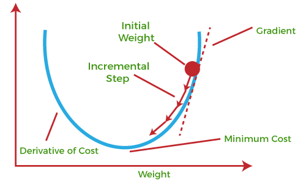
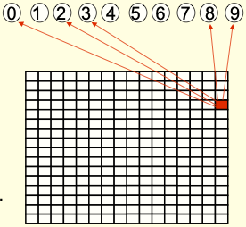
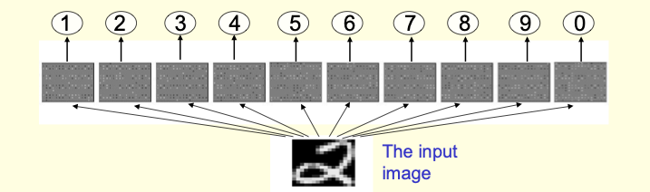
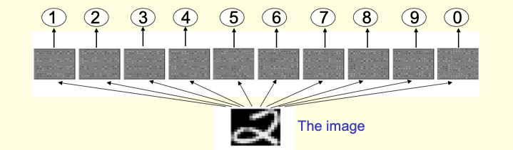
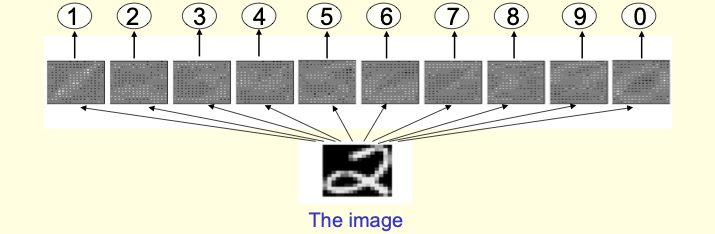
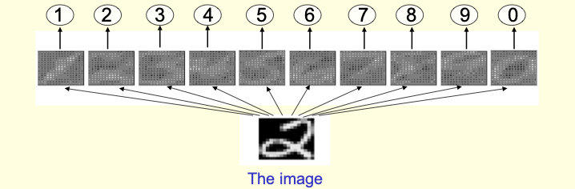
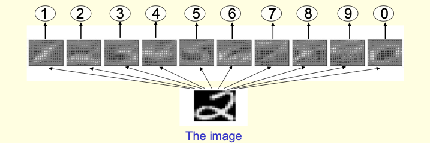
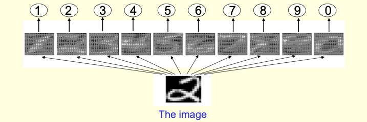
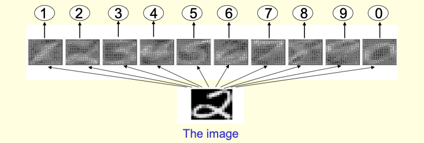
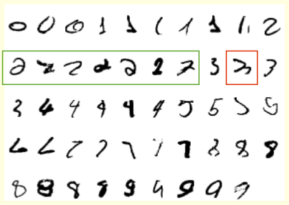

# **Modelos sencillitos de aprendizaje**

### Curso Reconocimiento de Patrones 

**LCC/UNISON**

Julio Waissman

---

# Problema de regresión

- $x = (x_1, \ldots, x_n) \in \mathrm{R}^n$
- $y \in \mathrm{R}$
- Conjunto de aprendizaje $\{(x^{(1)}, y^{(1)}), \ldots, (x^{(M)}, y^{(M)})\}$
- Usar la *matriz de diseño* $X$ y $Y$

---

# Regresión lineal

La hipótesis de base es:
$$h_\theta(x) = w_1 x_1 + \cdots + w_n x_n + b$$

- $\theta = (w_1, \ldots, w_n, b) \in \mathrm(R)^{n+1}$
- $w = (w_1, \ldots, w_n)$ vector de pesos (*weights*) y $b$ el sesgo (*bias*)

---

# Una funcion de pérdida

$$loss(y, \hat{y}) = \frac{1}{2} (y - \hat{y})^2$$

$$\hat{y} = h_\theta(x) = \sum_{j = 1}^n w_j x_j + b = x^T w + b$$

---

# El error en muestra

$$E_i(h_\theta) = \frac{1}{M} \sum_{i = 1}^M \frac{1}{2}\big(y^{(i)} - (w^T x^{(i)} + b)\big)^2$$

- Se conoce como *Error cuadrado medio* (MSE)
- Se puede resolver en forma analítica
- Vamos a resolverlo en forma numérica 

---

# Descenso de gradiente




- [GD en Wikipedia](https://en.wikipedia.org/wiki/Gradient_descent)

---

# El algoritmo de mínimos cuadrados 

```python
def grad_desc(w0, b0, X, y, lr, max_epoch):

  M = y.shape[0]
  w, b = w0.copy(), b0
  e_hist = []
  for _ in range(max_epoch):
    y_est = X @ w0 + b
    e = np.square(y - y_est).mean() / 2
    dw = -(X.T @ (y - y_est)) / M
    db = -(y - y_est).mean()
    w -= lr * dw
    b -= lr * db
    e_hist.append(e)
  return w, b, e_hist
```
---

# Algunas preguntas

1. ¿Cuando sirve el modelo de regresión lineal?
2. ¿El MSE es la mejor función de pérdida?
3. ¿Cómo se podría extender a que fuera más útil?

---

# Problema de clasificación binaria

- $x = (x_1, \ldots, x_n) \in \mathrm{R}^n$
- $y \in \{-1, 1\}$
- Conjunto de aprendizaje $\{(x^{(1)}, y^{(1)}), \ldots, (x^{(M)}, y^{(M)})\}$

---

# Clasificación lineal

La hipótesis de base es:
$$h_\theta(x) = \text{sign} \big(w_1 x_1 + \cdots + w_n x_n + b\big)$$

- $\theta = (w_1, \ldots, w_n, b) \in \mathrm(R)^{n+1}$
- $w = (w_1, \ldots, w_n)$ vector de pesos (*weights*) y $b$ el sesgo (*bias*)

---

# La funcion de pérdida mas simple

$$loss(y, \hat{y}) = [\![y \neq \hat{y}]\!]$$

$$\hat{y} = h_\theta(x) = \sum_{j = 1}^n w_j x_j + b = x^T w + b$$

La operación $[\![p]\!]$ se conoce como *Iverson bracket* y es la función indicadora.

---

# El error en muestra

$$E_i(h_\theta) = \frac{1}{M} \sum_{i = 1}^M [\![y^{(i)} \neq (w^T x^{(i)} + b)]\!]$$

- Se conoce como *0/1 Loss*
- Vamos a resolverlo con el PLA

---

# Perceptron Learning Algorithm (PLA)

```python
def pla(x, y, alpha, max_epochs):
  M, n = x.shape
  indicadores = list(range(n))
  w, b = np.random.random((n, )), np.random.random()
  for _ in max_epochs:
    random.shuffle(indicadores)
    for i in indicadores:
      if y[i] != np.sign(x[i,:] @ w + b):
        w += alpha * y[i] * x[i,:] 
        b += alpha * y[i]
        break
    else:
      break
  return w, b
```

---

# Ejemplo de perceptrón



---


# Ejemplo de perceptrón



---


# Ejemplo de perceptrón



---


# Ejemplo de perceptrón



---


# Ejemplo de perceptrón



---


# Ejemplo de perceptrón



---


# Ejemplo de perceptrón



---


# Ejemplo de perceptrón



---


# Ejemplo de perceptrón


---


# Ejemplo de perceptrón



---

# Algunos problemas

- ¿El PLA tiene solución única?
- ¿El PLA asegura convergencia en algún sentido?
- ¿La *0/1 Loss* es la mejor función de costo?

---

# Otra forma de hacer clasificación

¿Y si convertimos el problema de clasificación en un problema de regresión?

$$\Pr[y = 1 | x; \theta] = g_\theta(x) \in [0, 1]$$

$$h_\theta(x) = \left\{\begin{array} 1 1 & \text{si }g_\theta(x) > u \\ -1 & \text{en otro caso} \end{array}\right.$$

- Un problema de regresión (encontrar $\theta$)
- Un problema de clasificación (encontrar el umbral $u$)

---
# Empezams por el final: la clasificación

$$\hat{y} = h_\theta(x) = \left\{\begin{array} 1 & \text{si }g_\theta(x) > u \\ -1 & \text{en otro caso} \end{array}\right.$$

- El umbral $u$ es un hiperparámetro 
- Ante la falta de información, se puede usar $u = 0.5$ como valor por defecto
- Es necearo establecer *métricas* para escoger la mejor $u$ (subjetivo)

---

# La regresión 

La regresión la pondremos en términos *lineales*

$$\Pr[y = 1 | x; \theta] = g(x^T w + b) = a \in [0, 1]$$

- $\theta = (w_1, \ldots, w_n, b) \in \mathrm(R)^{n+1}$
- $g(z)$ es una función de activación que mapea $\mathrm{R} \to [0, 1]$
- $g(z)$ es monótona creciente y diferenciable
- $\lim_{z \to -\infty} g(z) = 0$ y $\lim_{z \to \infty} g(z) = 1$

---

# La funcion de activación $g$

La función de activación más común es la función sigmoide o *logística*:
$$g(z) = \frac{1}{1 + e^{-z}}$$

Y su dervidada es:
$$\frac{dg(z)}{dz} = g(z)(1 - g(z))$$

¿Porqué la función logística y no otra? Lo veremos cuando hablemos de GLM

# Función de costo

- Ahora tenemos una función $g_\theta: \mathrm{R}^n \to [0, 1]$ que nos da la probabilidad de que $y = 1$ dado $x$ y $\theta$.
- La función de costo 0/1 ya no aplica en este problema.
- Podemos usar funciones de costo diferenciables.

---

# La *entropía cruzada*

$$E_i(g_\theta) = -\frac{1}{M} \sum_{i = 1}^M \big[y^{(i)} \log g_\theta(x^{(i)}) + (1 - y^{(i)}) \log (1 - g_\theta(x^{(i)}))\big]$$

- Si $y^{(i)} = 1$, $1-y^{(i)} = 0$, por lo tanto un término siempre se anula.
- Es equivalete a la suma de los logaritmos de las diferencias entre las probabilidades predichas y las observadas.
- Si el error es 0, el costo local es 0, si el error es 1, el costo local es infinito. Por lo tanto, la función de costo penaliza fuertemente los errores.

---

# ¿Y como se calculan los gradientes?

$$ \frac{\partial E_i(g_\theta)}{\partial w_j} = -\frac{1}{M} \sum_{i = 1}^M (y^{(i)} - g_\theta(x^{(i)})) x_j^{(i)}$$

- Lo dejamos como trabajo a entregar para que lo comprueben. La derivada parcial con respecto a $b$ es similar. 
- Para subir hoy como tarea de Teams. Escrito a mano y subir como imagen.

---

# El algoritmo queda similar al de regresión lineal

```python
def grad_desc(w0, b0, X, y, lr, max_epoch):
  M = y.shape[0]
  w, b = w0.copy(), b0
  e_hist = []
  for _ in range(max_epoch):
    a = 1 / (1 + np.exp(-(X @ w0 + b)))
    e = -np.mean(y * np.log(a) + (1 - y) * np.log(1 - a))
    dw = -(X.T @ (y - a)) / M
    db = -(y - a).mean()
    w -= lr * dw
    b -= lr * db
    e_hist.append(e)
  return w, b, e_hist
```
---
# ¿Que es un buen clasificador?

- ¿Que necesitamos si queremos reconocer piezas buenas de malas?
- ¿Y si queremos detectar intrusos a una red?
- ¿Y si queremos detectar una probable enfermedad?

**¿Que significa tener un clasificador *bueno*?**
